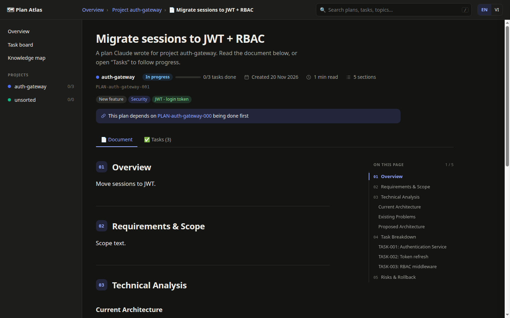

<div align="center">

# Plan Atlas

**A local workspace for the implementation plans Claude Code writes, tracked across all your projects.**

[](https://github.com/wik1ngst-1103/plan-atlas/actions/workflows/ci.yml)
[](LICENSE)

[](https://wik1ngst-1103.github.io/plan-atlas/)

**English** · [Tiếng Việt](README.vi.md)

</div>

<p align="center">
  
</p>

Plan Atlas collects the plans Claude Code produces, organizes them by project and presents each one as a structured document with tasks you can track. While Claude works, it shows which task is in progress and what each subagent is doing, in plain language that non-developers can follow. Everything runs on your machine from a single binary.

## Contents

- [Features](#features)
- [Installation](#installation)
- [Getting started](#getting-started)
- [Usage](#usage)
- [Claude Code integration](#claude-code-integration)
- [Configuration](#configuration)
- [Plan format](#plan-format)
- [Architecture](#architecture)
- [Security and privacy](#security-and-privacy)
- [Contributing](#contributing)
- [License](#license)

## Features

- **Central plan store.** Plans from every project live in one place, grouped by project. Plans already in `~/.claude/plans` are imported automatically, and plans stored anywhere else can be imported from a file or folder. Source files are never modified.
- **Plans as documents.** A consistent structure (Overview, Requirements & Scope, Technical Analysis, Task Breakdown, Risks & Rollback) with a section outline that follows your reading position.
- **Task tracking.** Each task carries a status, a complexity score from 1 to 5 and a recommended model and effort level. Update tasks from a board by drag and drop.
- **Live activity.** See which task Claude is working on and what each subagent is doing, nested under the relevant plan. Raw tool calls are available on demand.
- **Knowledge map.** Topics come from a shared, editable taxonomy. A graph shows how plans relate through dependencies and shared topics.
- **Search.** Full-text search across plans, tasks and topics, insensitive to diacritics.
- **Bilingual interface.** English and Vietnamese, selected from the browser language.
- **Lightweight.** A single binary of about 9 MB that uses roughly 16 MB of memory at idle with 1,000 plans.

## Installation

> Prebuilt packages are published starting with v0.1.0.

| Platform | Command |
|---|---|
| macOS, Linux | `curl --proto '=https' --tlsv1.2 -LsSf https://github.com/wik1ngst-1103/plan-atlas/releases/latest/download/plan-atlas-installer.sh \| sh` |
| Windows (PowerShell) | `powershell -ExecutionPolicy Bypass -c "irm https://github.com/wik1ngst-1103/plan-atlas/releases/latest/download/plan-atlas-installer.ps1 \| iex"` |
| Homebrew | `brew install wik1ngst-1103/tap/plan-atlas` |
| npm | `npm install -g plan-atlas` |

Install globally. Running through `npx` is not supported, because Claude Code needs a stable path to the binary.

<details>
<summary>Build from source</summary>

Requires Rust 1.89 or later and Node.js 22 or later. The web interface is compiled into the binary.

```sh
git clone https://github.com/wik1ngst-1103/plan-atlas.git
cd plan-atlas
(cd web && npm ci && npm run build)
cargo build --release
# binary: target/release/plan-atlas
```

</details>

## Getting started

```sh
plan-atlas
```

On first launch, Plan Atlas:

1. offers to connect to Claude Code (see [Claude Code integration](#claude-code-integration)),
2. imports existing plans from `~/.claude/plans`,
3. opens the interface at `http://127.0.0.1:7420`.

Running the command again while Plan Atlas is already running opens a new browser tab instead of starting a second instance.

## Usage

### Commands

| Command | Description |
|---|---|
| `plan-atlas` | Start the application and open the browser. Options: `--port <n>`, `--no-open`. |
| `plan-atlas setup [--yes]` | Connect Plan Atlas to Claude Code. |
| `plan-atlas uninstall-claude [--yes]` | Remove everything `setup` added. Other settings are left untouched. |
| `plan-atlas import [PATH]... [--project <name>]` | Import plans. Without a path, imports `~/.claude/plans`. |
| `plan-atlas task start\|done <plan-id> <task-id>` | Update a task's status from the command line. |
| `plan-atlas mcp` | Run the MCP server over stdio. Started by Claude Code. |
| `plan-atlas hook` | Handle a Claude Code hook event. Invoked by Claude Code. |

### Importing plans

Plans kept outside `~/.claude/plans` can be imported from the interface or the command line. Imports are idempotent: importing an unchanged file again has no effect.

- **Interface:** select **Import plans** below the project list, choose Markdown files or a folder, select a target project and confirm.
- **Command line:**

  ```sh
  plan-atlas import ~/notes/plans --project my-app
  ```

  Folders are searched recursively for `*.md` files. Hidden directories, `node_modules` and `target` are skipped. Without `--project`, each plan is assigned to the Git repository that contains it, then to the project of the Claude Code session that wrote it, and otherwise to `unsorted`.

## Claude Code integration

`plan-atlas setup` makes three changes to your Claude Code configuration:

| Change | Location |
|---|---|
| Installs a Skill that tells Claude where and how to write plans | `~/.claude/skills/plan-atlas/SKILL.md` |
| Adds hooks for `PreToolUse`, `SubagentStart`, `SubagentStop` and `SessionEnd` | `~/.claude/settings.json` (a timestamped backup is written first; existing hooks are preserved) |
| Registers the MCP server | `claude mcp add --transport stdio --scope user plan-atlas -- plan-atlas mcp` |

With the integration in place, Claude creates plans through the MCP server, records task progress, and links related plans. Plans written in Claude Code's plan mode are registered after you approve them. To revert all changes, run `plan-atlas uninstall-claude`.

## Configuration

| Setting | Default | Override |
|---|---|---|
| Data directory | `~/.plan-atlas` | `PLAN_ATLAS_HOME` environment variable |
| Port | `7420`, falling back up to `7430` | `--port` or `PLAN_ATLAS_PORT` |
| Claude Code directory | `~/.claude` | `CLAUDE_CONFIG_DIR` |
| Interface language | Browser language (English or Vietnamese) | Language switch in the top bar |
| Topic taxonomy | `~/.plan-atlas/taxonomy.toml` | Edit the file, then run `plan-atlas setup` to update the Skill |

## Plan format

Plans are Markdown files with YAML front matter. Claude creates them through the MCP server, so writing them by hand is rarely necessary. Manual edits are supported: files are re-indexed on save, and structural problems appear as warnings in the interface rather than errors.

<details>
<summary>Example</summary>

```markdown
---
id: PLAN-auth-gateway-001
project: auth-gateway
title: Migrate sessions to JWT + RBAC
tags: [type/feature, domain/security, tech/jwt]
related:
  - { to: PLAN-auth-gateway-000, type: depends_on }
created: 2026-11-20
---
## 01. Overview
## 02. Requirements & Scope
## 03. Technical Analysis
### Current Architecture
### Existing Problems
### Proposed Architecture
## 04. Task Breakdown
### TASK-001: Authentication Service
- complexity: 4
- model: opus
- effort: medium
- status: todo
- tags: [tech/jwt]

Description and acceptance criteria.
## 05. Risks & Rollback
```

Supported relation types: `depends_on`, `extends`, `relates_to`. Task statuses: `todo`, `in_progress`, `review`, `done`.

</details>

## Architecture

```
Claude Code ── MCP (stdio) ── plan-atlas mcp ──┐
Claude Code ── hooks ──────── plan-atlas hook ─┼──► SQLite index ◄── plan-atlas server (127.0.0.1)
~/.plan-atlas/plans/*.md ◄─── file watcher ────┘                            ▲
                                                                        browser
```

- A single Rust binary provides the web server, MCP server, hook handler and installer. The Svelte interface is embedded in it.
- Markdown files are the source of truth. The SQLite database is an index that can be deleted and rebuilt at any time.
- Live updates reach the browser over Server-Sent Events.

## Security and privacy

- No telemetry. The server listens only on `127.0.0.1` and makes no outbound connections.
- Requests are rejected unless the `Host` header names the local server, which protects against DNS rebinding. Write requests also require a custom header.
- Plan content is sanitized before rendering.
- The hook handler is designed never to interfere with Claude Code: it always exits with code 0, prints nothing and finishes within 200 ms.

To report a vulnerability, see [SECURITY.md](SECURITY.md).

## Contributing

Contributions are welcome, including code, translations, taxonomy topics, documentation and bug reports. See [CONTRIBUTING.md](CONTRIBUTING.md) for the development setup and guidelines. All participants are expected to follow the [Code of Conduct](CODE_OF_CONDUCT.md).

## Roadmap

- Run as a background service (launchd, systemd, Windows service)
- Per-task cost and token usage
- Export a plan as a shareable static page
- Additional interface languages

## License

Released under the [MIT License](LICENSE).
