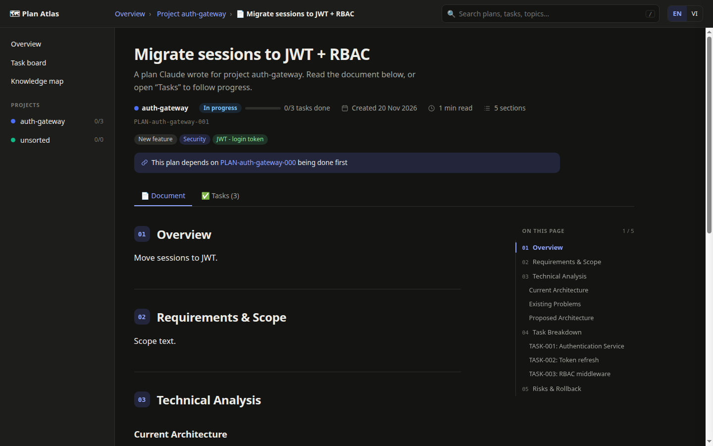

<div align="center">

# Plan Atlas

**Không gian làm việc cục bộ cho các plan triển khai do Claude Code tạo ra, theo dõi xuyên suốt mọi dự án.**

[](https://github.com/wik1ngst-1103/plan-atlas/actions/workflows/ci.yml)
[](LICENSE)

[](https://wik1ngst-1103.github.io/plan-atlas/)

[English](README.md) · **Tiếng Việt**

</div>

<p align="center">
  
</p>

Plan Atlas thu thập các plan Claude Code tạo ra, sắp xếp theo dự án và trình bày mỗi plan thành một tài liệu có cấu trúc, kèm danh sách việc có thể theo dõi. Trong lúc Claude làm việc, ứng dụng cho biết việc nào đang được thực hiện và từng trợ lý (subagent) đang làm gì, bằng ngôn ngữ dễ hiểu cả với người không chuyên kỹ thuật. Toàn bộ chạy trên máy của bạn, từ một file thực thi duy nhất.

## Mục lục

- [Tính năng](#tính-năng)
- [Cài đặt](#cài-đặt)
- [Bắt đầu](#bắt-đầu)
- [Sử dụng](#sử-dụng)
- [Tích hợp Claude Code](#tích-hợp-claude-code)
- [Cấu hình](#cấu-hình)
- [Định dạng plan](#định-dạng-plan)
- [Kiến trúc](#kiến-trúc)
- [Bảo mật và quyền riêng tư](#bảo-mật-và-quyền-riêng-tư)
- [Đóng góp](#đóng-góp)
- [Giấy phép](#giấy-phép)

## Tính năng

- **Kho plan tập trung.** Plan của mọi dự án nằm ở một nơi, phân nhóm theo dự án. Plan có sẵn trong `~/.claude/plans` được nhập tự động; plan lưu ở nơi khác có thể nhập theo file hoặc thư mục. File gốc không bao giờ bị sửa.
- **Plan dạng tài liệu.** Cấu trúc thống nhất (Tổng quan, Yêu cầu & phạm vi, Phân tích kỹ thuật, Chia nhỏ công việc, Rủi ro & phương án lùi), kèm mục lục theo sát vị trí đang đọc.
- **Theo dõi công việc.** Mỗi việc có trạng thái, độ khó từ 1 đến 5, model và mức suy nghĩ được khuyến nghị. Cập nhật bằng kéo thả trên bảng công việc.
- **Hoạt động trực tiếp.** Biết Claude đang làm việc nào và từng trợ lý đang làm gì, hiển thị ngay dưới plan tương ứng. Lệnh gốc có thể xem khi cần.
- **Bản đồ kiến thức.** Chủ đề lấy từ một bộ phân loại dùng chung, có thể chỉnh sửa. Đồ thị thể hiện quan hệ phụ thuộc và chủ đề chung giữa các plan.
- **Tìm kiếm.** Tìm toàn văn trong plan, việc và chủ đề, không phân biệt dấu tiếng Việt.
- **Giao diện song ngữ.** Tiếng Anh và tiếng Việt, tự chọn theo ngôn ngữ trình duyệt.
- **Gọn nhẹ.** Một file khoảng 9 MB, dùng khoảng 16 MB bộ nhớ khi rảnh với 1.000 plan.

## Cài đặt

> Bản dựng sẵn được phát hành từ phiên bản v0.1.0.

| Nền tảng | Lệnh |
|---|---|
| macOS, Linux | `curl --proto '=https' --tlsv1.2 -LsSf https://github.com/wik1ngst-1103/plan-atlas/releases/latest/download/plan-atlas-installer.sh \| sh` |
| Windows (PowerShell) | `powershell -ExecutionPolicy Bypass -c "irm https://github.com/wik1ngst-1103/plan-atlas/releases/latest/download/plan-atlas-installer.ps1 \| iex"` |
| Homebrew | `brew install wik1ngst-1103/tap/plan-atlas` |
| npm | `npm install -g plan-atlas` |

Cần cài toàn cục. Không hỗ trợ chạy qua `npx`, vì Claude Code cần một đường dẫn cố định tới file thực thi.

<details>
<summary>Build từ mã nguồn</summary>

Cần Rust 1.89 trở lên và Node.js 22 trở lên. Giao diện web được biên dịch vào file thực thi.

```sh
git clone https://github.com/wik1ngst-1103/plan-atlas.git
cd plan-atlas
(cd web && npm ci && npm run build)
cargo build --release
# file thực thi: target/release/plan-atlas
```

</details>

## Bắt đầu

```sh
plan-atlas
```

Ở lần chạy đầu, Plan Atlas sẽ:

1. đề nghị kết nối với Claude Code (xem [Tích hợp Claude Code](#tích-hợp-claude-code)),
2. nhập các plan có sẵn trong `~/.claude/plans`,
3. mở giao diện tại `http://127.0.0.1:7420`.

Chạy lại lệnh khi Plan Atlas đang chạy sẽ mở thêm một tab trình duyệt thay vì khởi động phiên bản thứ hai.

## Sử dụng

### Các lệnh

| Lệnh | Mô tả |
|---|---|
| `plan-atlas` | Khởi động ứng dụng và mở trình duyệt. Tuỳ chọn: `--port <n>`, `--no-open`. |
| `plan-atlas setup [--yes]` | Kết nối Plan Atlas với Claude Code. |
| `plan-atlas uninstall-claude [--yes]` | Gỡ mọi thứ `setup` đã thêm; các cài đặt khác giữ nguyên. |
| `plan-atlas import [ĐƯỜNG_DẪN]... [--project <tên>]` | Nhập plan. Không có đường dẫn thì nhập từ `~/.claude/plans`. |
| `plan-atlas task start\|done <plan-id> <task-id>` | Cập nhật trạng thái việc từ dòng lệnh. |
| `plan-atlas mcp` | Chạy MCP server qua stdio. Do Claude Code khởi động. |
| `plan-atlas hook` | Xử lý sự kiện hook của Claude Code. Do Claude Code gọi. |

### Nhập plan

Plan lưu ngoài `~/.claude/plans` có thể nhập từ giao diện hoặc dòng lệnh. Nhập lại một file không thay đổi sẽ không có tác dụng gì.

- **Giao diện:** chọn **Import plans** bên dưới danh sách dự án, chọn file Markdown hoặc một thư mục, chọn dự án đích rồi xác nhận.
- **Dòng lệnh:**

  ```sh
  plan-atlas import ~/notes/plans --project my-app
  ```

  Thư mục được quét đệ quy để tìm file `*.md`; bỏ qua thư mục ẩn, `node_modules` và `target`. Nếu không có `--project`, mỗi plan được gán vào Git repository chứa nó, sau đó là dự án của phiên Claude Code đã viết plan, cuối cùng là `unsorted`.

## Tích hợp Claude Code

`plan-atlas setup` thực hiện ba thay đổi trong cấu hình Claude Code:

| Thay đổi | Vị trí |
|---|---|
| Cài Skill hướng dẫn Claude tạo plan ở đâu và theo cấu trúc nào | `~/.claude/skills/plan-atlas/SKILL.md` |
| Thêm hook cho `PreToolUse`, `SubagentStart`, `SubagentStop` và `SessionEnd` | `~/.claude/settings.json` (sao lưu kèm thời gian trước khi ghi; giữ nguyên hook sẵn có) |
| Đăng ký MCP server | `claude mcp add --transport stdio --scope user plan-atlas -- plan-atlas mcp` |

Khi đã tích hợp, Claude tạo plan qua MCP server, ghi nhận tiến độ từng việc và liên kết các plan liên quan. Plan viết trong plan mode của Claude Code được đăng ký sau khi bạn duyệt. Để hoàn tác toàn bộ, chạy `plan-atlas uninstall-claude`.

## Cấu hình

| Thiết lập | Mặc định | Thay đổi bằng |
|---|---|---|
| Thư mục dữ liệu | `~/.plan-atlas` | Biến môi trường `PLAN_ATLAS_HOME` |
| Cổng | `7420`, tự lùi tới `7430` | `--port` hoặc `PLAN_ATLAS_PORT` |
| Thư mục Claude Code | `~/.claude` | `CLAUDE_CONFIG_DIR` |
| Ngôn ngữ giao diện | Theo trình duyệt (tiếng Anh hoặc tiếng Việt) | Nút đổi ngôn ngữ trên thanh trên cùng |
| Bộ phân loại chủ đề | `~/.plan-atlas/taxonomy.toml` | Sửa file rồi chạy `plan-atlas setup` để cập nhật Skill |

## Định dạng plan

Plan là file Markdown có phần front matter YAML. Claude tạo plan qua MCP server nên hiếm khi cần viết tay. Vẫn có thể sửa tay: file được lập chỉ mục lại khi lưu, lỗi cấu trúc hiển thị thành cảnh báo trong giao diện thay vì làm hỏng ứng dụng.

<details>
<summary>Ví dụ</summary>

```markdown
---
id: PLAN-auth-gateway-001
project: auth-gateway
title: Migrate sessions to JWT + RBAC
tags: [type/feature, domain/security, tech/jwt]
related:
  - { to: PLAN-auth-gateway-000, type: depends_on }
created: 2026-11-20
---
## 01. Overview
## 02. Requirements & Scope
## 03. Technical Analysis
### Current Architecture
### Existing Problems
### Proposed Architecture
## 04. Task Breakdown
### TASK-001: Authentication Service
- complexity: 4
- model: opus
- effort: medium
- status: todo
- tags: [tech/jwt]

Mô tả và tiêu chí hoàn thành.
## 05. Risks & Rollback
```

Loại quan hệ hỗ trợ: `depends_on`, `extends`, `relates_to`. Trạng thái việc: `todo`, `in_progress`, `review`, `done`.

</details>

## Kiến trúc

```
Claude Code ── MCP (stdio) ── plan-atlas mcp ──┐
Claude Code ── hooks ──────── plan-atlas hook ─┼──► chỉ mục SQLite ◄── plan-atlas server (127.0.0.1)
~/.plan-atlas/plans/*.md ◄─── theo dõi file ───┘                              ▲
                                                                          trình duyệt
```

- Một file thực thi Rust đảm nhận web server, MCP server, xử lý hook và trình cài đặt. Giao diện Svelte được nhúng sẵn bên trong.
- File Markdown là nguồn dữ liệu gốc. Cơ sở dữ liệu SQLite chỉ là chỉ mục, có thể xoá và dựng lại bất cứ lúc nào.
- Cập nhật trực tiếp được đẩy tới trình duyệt qua Server-Sent Events.

## Bảo mật và quyền riêng tư

- Không thu thập dữ liệu sử dụng. Server chỉ lắng nghe ở `127.0.0.1` và không kết nối ra ngoài.
- Request bị từ chối nếu header `Host` không phải server cục bộ, giúp chống DNS rebinding. Request ghi dữ liệu còn phải có header riêng.
- Nội dung plan được làm sạch trước khi hiển thị.
- Bộ xử lý hook được thiết kế để không bao giờ ảnh hưởng Claude Code: luôn thoát với mã 0, không in ra gì và kết thúc trong 200 ms.

Để báo lỗ hổng bảo mật, xem [SECURITY.md](SECURITY.md).

## Đóng góp

Hoan nghênh mọi đóng góp: mã nguồn, bản dịch, chủ đề cho bộ phân loại, tài liệu và báo lỗi. Xem [CONTRIBUTING.md](CONTRIBUTING.md) để biết cách thiết lập môi trường và quy ước. Mọi người tham gia cần tuân thủ [Quy tắc ứng xử](CODE_OF_CONDUCT.md). Issue và pull request viết bằng tiếng Việt cũng được chấp nhận.

## Lộ trình

- Chạy nền như dịch vụ hệ điều hành (launchd, systemd, Windows service)
- Chi phí và lượng token theo từng việc
- Xuất plan thành trang tĩnh để chia sẻ
- Thêm ngôn ngữ giao diện

## Giấy phép

Phát hành theo [giấy phép MIT](LICENSE).
